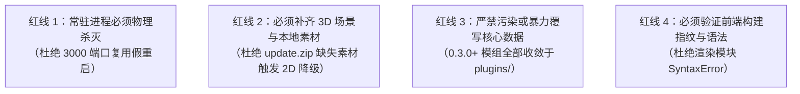
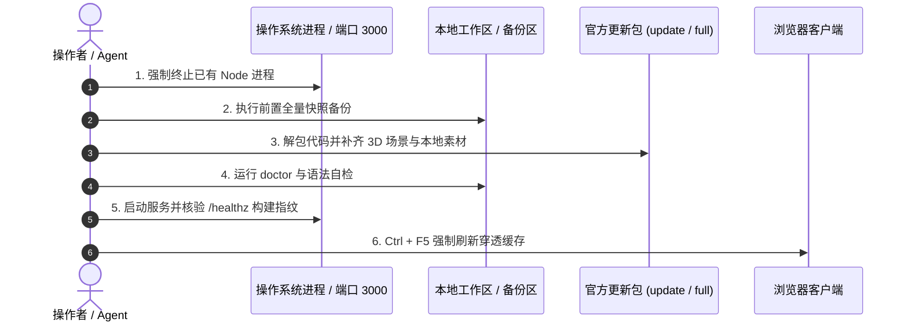

# Stronghold Protocol 项目官方更新规范与操作手册

> **适用对象**：所有在本仓库执行版本升级的开发人员与 AI 协作窗口（Claude / Gemini）。  
> **制定背景**：解决历次官方版本更新后频繁出现的「服务端假重启运行旧代码」、「素材缺失导致 3D 渲染静默降级」、「前端激进缓存导致新功能未显现」以及「暴力覆盖导致本地模组被抹除」等顽疾。

---

## 一、核心风险与更新红线

在执行任何官方更新前，必须严格遵守以下四大红线：



### 1. 守护进程端口复用假重启（最隐蔽的假更新幽灵）
- **根因**：启动器脚本 `scripts/launch.mjs` 检测到 3000 端口已被旧版 Node.js 监听时，会直接输出 `服务器已经在运行，直接打开浏览器` 并**跳过服务重启**。
- **后果**：Node.js 在内存中常驻所有旧模块。磁盘代码更新后，旧进程依然对外提供旧逻辑，且 `server/http/buildTag.js` 的构建指纹在进程生命周期内是单例常量，导致浏览器客户端的 `buildGuard.js` 永远等不到新标签，**绝不触发热重载**。
- **红线**：**更新前后必须显式执行命令强制杀死已有 Node 进程，严禁仅凭双击启动脚本完成更新！**

### 2. 官方更新包资产分工陷阱（静默降级为 2D 棋盘）
- **根因**：官方 GitHub Release 提供的 `Stronghold-Protocol-vX.Y.Z-update.zip`（增量包 ~267MB）与 `lite.zip`（精简包 ~25MB）**默认不含完整的 3D 战场场景素材与着色器贴图**（位于 `public/assets/local/scene/` 与 `data/local-assets.json`）。
- **后果**：若仅解包 `update.zip`，渲染器因找不到 3D 场景素材，会触发官方内置的**安全防御降级机制**：
  - 3D 战场与场景模型加载失败 → **静默回退为 v0.1/v0.2 纯金属 Canvas 2D 棋盘**；
  - 特效切片缺失 → **退化为通用火花**；
  - 干员切片缺失 → **退化为几何职业菱形**。
- **红线**：**更新时必须从同版本完整包（`Stronghold-Protocol-vX.Y.Z.zip`）同步场景素材，或运行 `node tools/setup.mjs --scenes` 提取，严禁仅拷贝精简代码包！**

### 3. 模组与核心数据解耦准则（0.3.0+ 规范）
- **根因**：过去版本采用侵入式修改（直接篡改 `data/chess.json`、`data/bonds.json`、`server/sim/content/`），更新时整仓覆盖会导致所有自制模组被清洗抹除；手动拼接代码又极易出现重复定义（如 0.2.6 `units.js` 语法错误）。
- **红线**：**在 0.3.0 及更高版本中，所有自定义干员、装备与脚本必须收敛于 `plugins/<id>/`，严禁向根目录 `data/*.json` 注入非官方内容。**
- **⚠️ 唯一例外：盟约（bonds）层必须留在根目录（2026-10-17 实测确认）**：0.3.0 的插件体系**在原理上无法新增盟约**——`shared/plugins/patch.js` 的 `RECORD_MAPS` 没有 `bonds`，`{op:"add",file:"bonds",id:"…"}` 实测报 `PLUGIN_RECORD_ID`；`{records:1}` 的支持列表（enemies/waves/stages/modes/items/bands/garrisons/effects/tokens/choices）也没有 bonds；脚本插件只能注册 `kits/enemies/content/meta`。因此：
  - **必须保留的「盟约层」**（细节与理由见 `AGENT-COORD.md` §3「0.3.0 插件体系下的盟约层」；四个盟约：罗德岛 / Ave Mujica / 边狱公司 / 圆桌）：
    1. `data/bonds.json` 的 `rhodesShip` / `aveMujicaShip` / `limbusShip` / `roundTable`（27 条 = 官方 23 + 4）；
    2. `data/effects.json` 的 `bondeffect_rhodes` / `bondeffect_ave_mujica` / `bondeffect_limbus_company` / `bondeffect_round_table`（缺任一条，内容集校验报 `PLUGIN_DATA_REFERENCE`）；
    3. `server/sim/content/bonds.js` 里加载 `./mods/rhodes/bonds.js`、`./mods/aveMujica/bonds.js`、`./mods/limbusCompany/bonds.js`、`./mods/fgoRoundTable/bonds.js` 的四段 PARTS（盟约的战斗/备战逻辑）；`mods/*/sim/bonds.js` 是源、`server/sim/content/mods/*/bonds.js` 是部署副本，两边要同步；
    4. 插件干员的 `chess.bonds` 指回自家盟约（`plugins/{rhodes,ave-mujica,limbus-company,fgo-round-table}/operators/*.json`）；盟约 `members` 不要手写，房间内容集由 expander 自动填 `chess_x_*`；
    5. 四个外观包（含 `limbus-look`、`fgo-round-table-look`）的 `art/assets.json` 里的 `bonds` 图标映射 + 重签的 `plugin.lock.json`。
  - **升级后重贴**：`node scratch/restore-covenants.mjs`（data，幂等）+ `node scratch/restore-covenant-links.mjs`（插件干员归属/图标，幂等）+ bonds.js 的四段 PARTS（手工 Edit）。
  - **验收**：`node scratch/probe-covenant-battle.mjs`（13/13：罗德岛满血治疗转屏障、Mujica 伤害/技费、边狱每层伤害、圆桌攻防）；真浏览器 `CHROME_PATH="C:\Program Files\Google\Chrome\Application\chrome.exe" node scratch/e2e-loadout-bonds2.mjs`（盟约下拉出现「罗德岛 / Ave Mujica / 边狱公司 / 圆桌」且各自列出 6/10/24/30 个棋子里的干员）。
  - 代价：`server/sim/content/bonds.js`、`data/{bonds,effects}.json` 会与官方 `MANIFEST.json` 哈希不同——这是已知且不可避免的偏差（插件体系补不上），升级时按上一条重贴即可；**其它**根目录文件仍须保持 100% 官方哈希。
- **房间默认插件（服主策略，不属于 mod 也不属于官方包）**：`plugins/config.json`（`rooms: "host"` + `default: [...]`）决定每个新房间自带哪些插件——本机现为 9 个：`["rhodes","rhodes-look","ave-mujica","ave-mujica-look","limbus-company","limbus-look","fgo-round-table","fgo-round-table-look","recruits"]`，玩家建房即可用模组干员/盟约，不必去房间面板手动开。**升级/清理时不要删它**。
- **房间插件入口「插件选择」也是有意偏离（别还原）**：`public/js/ui/pluginTag.js` + `public/css/components.css` 的 `.plugtag--entry` 把入口从「原版」改成「插件选择 · N」。这两个文件在 `MANIFEST.json` 里，`node tools/doctor.mjs` 会报不一致——**不要为了让 doctor 变绿而还原**（2026-10-17 已被还原过一次，用户要的入口当场丢失）；按已知偏差忽略。

### 4. 浏览器原生 ESM 缓存穿透
- **根因**：前端属于无打包器（No-bundler）原生 ES 模块架构，浏览器对 `/js/*.js` 的缓存机制极其激进。
- **红线**：更新完成后，**必须告知用户或在测试时执行 `Ctrl + F5` 强制刷新**，淘汰浏览器内存中的旧脚本缓存。

---

## 二、标准更新流程（SOP 六步操作手册）



### 步骤一：彻底停服与端口清空

在改动任何代码前，必须物理终止占用 3000 端口的所有 Node 进程：

```powershell
# Windows PowerShell
Stop-Process -Name node -Force -ErrorAction SilentlyContinue

# 确认 3000 端口已完全释放（无输出表示正常）
Get-NetTCPConnection -LocalPort 3000 -ErrorAction SilentlyContinue
```

### 步骤二：前置全量快照备份

将现有配置、定制模组及插件状态归档至独立目录：

```powershell
$stamp = Get-Date -Format 'yyyyMMdd-HHmmss'
$bak = "backup-pre-update-$stamp"
New-Item -ItemType Directory -Force -Path $bak | Out-Null

# 备份核心资产
Copy-Item -Path "plugins" -Destination "$bak\plugins" -Recurse -Force -ErrorAction SilentlyContinue
Copy-Item -Path "mods" -Destination "$bak\mods" -Recurse -Force -ErrorAction SilentlyContinue
Copy-Item -Path "data" -Destination "$bak\data" -Recurse -Force
Copy-Item -Path "server" -Destination "$bak\server" -Recurse -Force
Copy-Item -Path "public\js" -Destination "$bak\public\js" -Recurse -Force
Copy-Item -Path "tools" -Destination "$bak\tools" -Recurse -Force
foreach ($f in @('package.json', 'package-lock.json', 'MANIFEST.json', 'CHANGELOG.md', 'README.md', 'AGENT-COORD.md')) {
  if (Test-Path $f) { Copy-Item -Path $f -Destination "$bak\" -Force }
}
Write-Host "✔ 备份完成: $bak"
```

### 步骤三：解包官方更新并同步 3D 场景素材

1. **下载或解压更新包到 `update/` 目录**：
   - 官方更新包：`update/Stronghold-Protocol-v<version>-update/Stronghold-Protocol`
   - 同版本完整包（用于补齐场景素材）：`update/Stronghold-Protocol-v<version>/Stronghold-Protocol`
2. **覆盖代码与基础数据**：
   将更新包中的 `server/`、`shared/`、`public/js/`、`data/`、`tools/`、`schemas/` 覆盖至项目根目录。
3. **补齐 3D 战场场景素材与本地资产清单（关键步骤）**：
   ```powershell
   # 确保 3D 战场场景目录存在并完整
   if (Test-Path "update\Stronghold-Protocol-v<version>\Stronghold-Protocol\public\assets\local\scene") {
     Copy-Item -Path "update\Stronghold-Protocol-v<version>\Stronghold-Protocol\public\assets\local\scene" -Destination "public\assets\local\scene" -Recurse -Force
     Copy-Item -Path "update\Stronghold-Protocol-v<version>\Stronghold-Protocol\data\local-assets.json" -Destination "data\local-assets.json" -Force
   }
   ```
4. **运行素材完整性扫描**：
   ```powershell
   node tools/setup.mjs --check
   # 验收指标：必须输出「缺失文件数 0」，严禁残留缺失项引发启动无限死锁！
   ```

### 步骤四：安装依赖与全方位健康校验

1. **更新与补全 npm 依赖**：
   ```powershell
   npm install
   # postinstall 会自动执行 tools/vendor.mjs，同步 preact、pixi.js、three 等前端 vendor 库
   ```
2. **渲染层语法防崩溃校验（绝不能省）**：
   ```powershell
   node -e "import('./public/js/render/app.js').then(() => console.log('✔ 渲染模块语法校验通过'))"
   ```
3. **插件系统规范检查（0.3.0+）**：
   ```powershell
   node tools/plugin.mjs check --strict
   # 验收指标：全部 plugin 文件夹报 0 problem(s), 0 warning(s)
   ```
4. **全仓环境综合体检**：
   ```powershell
   node tools/doctor.mjs
   # 验收指标：
   # ✔ 文件校验 MANIFEST.json (与新版本一致)
   # ✔ 本地客户端美术（可选）(XX 项，3D 棋盘可用，已提取各战场官方场景)
   ```

### 步骤五：全新拉起服务与构建指纹核验

1. **启动服务**：
   ```powershell
   # 方式 A：双击 start-windows.bat
   # 方式 B：后台启动
   Start-Process -FilePath "node" -ArgumentList "server/index.js" -WindowStyle Hidden
   ```
2. **核验接口与构建标签（必须看到新版本和新 buildTag）**：
   ```powershell
   curl.exe -s http://localhost:3000/healthz
   ```
   **预期响应**：
   ```json
   {
     "ok": true,
     "version": 1,
     "app": "0.3.0",
     "build": "<全新的12位哈希>",
     "content": { ... }
   }
   ```
   如果 `app` 版本未更新或 `build` 未变，说明旧进程仍在占用，必须回到步骤一重新强制杀进程！

### 步骤六：前端缓存穿透与端到端验证

1. **提示或执行浏览器强刷**：
   - 打开游戏主页 `http://localhost:3000`；
   - 键盘按下 **`Ctrl + F5`**（强制清除该域名的脚本与样式缓存并完全重新拉取）。
2. **建房插件状态验证（0.3.0+）**：
   - 官方插件默认不在房间中自动加载；
   - 创建房间后，在房间界面的插件/外观选项栏中**勾选激活所需的自定义模组插件**；
   - 确认干员列表与模型正常加载。

---

## 三、常见故障排查速查表（Troubleshooting Matrix）

| 异常现象 | 根本原因 | 根治解决方案 |
|---|---|---|
| **页面依然是老版本 / 3D 地图不显示（金属平板）** | 1. 旧 Node.js 进程 PID 未死，端口被复用<br/>2. 浏览器缓存了旧版 ES 模块<br/>3. `public/assets/local/scene/` 素材未提取或丢失 | 1. 执行 `Stop-Process -Name node -Force`<br/>2. 浏览器按 `Ctrl + F5` 强刷<br/>3. 从完整包拷贝 scene 目录并确认 `local-assets.json` 存在 |
| **启动卡在 `1/8939 ... 0.00 MB/s` 无限死锁** | `data/assets.json` 中登记了本地磁盘上不存在的虚拟文件，触发了下载器死循环 | 运行 `node tools/setup.mjs --check`，清理 assets 表中缺失项，严禁向 assets 表塞虚假路径 |
| **进入对局后全场无立绘，全退化为几何方块** | 渲染层 JS 模块报 SyntaxError，Pixi 保护性降级到 2D Canvas | 运行 `node -e "import('./public/js/render/app.js').then(()=>console.log('OK'))"` 定位语法错误并还原文件 |
| **`node tools/doctor.mjs` 报 `MANIFEST.json` 不匹配** | 旧版模组侵入修改了 `data/chess.json` 或 `server/` 等受保护文件 | 将模组全部迁移至 `plugins/<id>/` 目录，将核心文件恢复至官方对应版本的纯净状态 |
| **自制干员/外观在对局中没有出现** | 0.3.0 插件系统安全规范：插件在房间中默认不开启 | 房主在建房面板的插件配置中勾选开启该插件包 |

---

## 四、更新完成验收清单（Checklist）

每次更新完成向用户汇报前，必须逐项核对并打勾：

- [ ] **进程检查**：旧 Node.js 进程已全部终止，端口 3000 已彻底重启；
- [ ] **接口指纹**：`curl http://localhost:3000/healthz` 返回的 `app` 与 `build` 均已更新；
- [ ] **资产完整**：`node tools/setup.mjs --check` 报告 `0 缺失`，且 3D 场景目录存在；
- [ ] **语法自检**：`render/app.js` 模块导入自检输出 `OK`，无 SyntaxError；
- [ ] **体检绿灯**：`node tools/doctor.mjs` 报告全部核心文件与新版本一致；
- [ ] **插件规范**：`node tools/plugin.mjs check --strict` 全部通过（**0 跳过、0 问题**；被跳过的插件在启动日志里只留一行，很容易漏）；
- [ ] **盟约层（§一.3 例外）**：`data/bonds.json` **27 条**且含 `rhodesShip`/`aveMujicaShip`/`limbusShip`/`roundTable`；`data/effects.json` 含 4 个 `bondeffect_*`；`server/sim/content/bonds.js` 含四段 mod PARTS；`node scratch/probe-covenant-battle.mjs` 输出 `全部通过`（13/13）；
- [ ] **房间默认插件**：`plugins/config.json` 存在且 `default` 为预期的 **9 个 id**（删了它=玩家建房后不会自带模组）；
- [ ] **入口改名未被还原（§一.3 末条）**：`public/js/ui/pluginTag.js` 里有「插件选择」、`public/css/components.css` 里有 `.plugtag--entry`（doctor 报这两条不一致属已知偏差）；
- [ ] **端到端（真浏览器，不许只跑单测）**：`CHROME_PATH="C:\Program Files\Google\Chrome\Application\chrome.exe" node scratch/e2e-loadout-bonds2.mjs` → 盟约下拉出现「罗德岛 / Ave Mujica / 边狱公司 / 圆桌」且各自列出干员；`node scratch/e2e-solo-defaults.mjs` → 独立模拟房间 `plugins` 为那 9 个、标签显示「插件选择 · 9」；
- [ ] **红灯交代**：已知红（`test/mods/aveMujica.test.js` 6/6、`test/mods/assistTopbond.test.js`、`test/match/diy-bonds.test.js` 2 项）必须如实报告，见 `docs/模组迁移交接.md`；
- [ ] **缓存告知**：已提醒用户在浏览器中按 `Ctrl + F5` 强制刷新。
